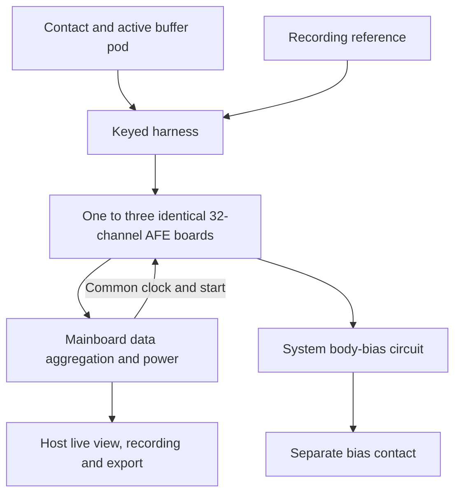

# Modular active-electrode EEG · Project instructions

## Mission

Develop a modular scalp EEG recorder from requirements to a reproducible prototype package. Deliver editable electrical and mechanical CAD, print and PCBA files, firmware, live-view and recording software, fixtures, and a local assembly and bring-up guide. The owner handles printing, physical assembly and bench work.

Start from one brief. Run executable checks, revise the design from evidence and continue independent work while physical results are pending. Keep the Git repo resumable.

## 1. Project inputs

On the first run, create `spec/project.yaml` with each input's value, status (`owner-set`, `provisional` or `open`), rationale and source. Use the owner's latest answers. Base the first four inputs on the owner's selections. Mark inferred details and the remaining defaults as provisional or open.

| Input | Baseline and open decisions |
|---|---|
| Intended use | Research scalp EEG recording, live viewing and raw export. Use seated adults as the initial fit and operating assumption. Rev A engineering work uses a bench phantom. A future human-use configuration requires its own safety and study decisions. |
| Electrode | Design a reusable active buffer pod around a replaceable commercial wet Ag/AgCl contact. Keep the high-impedance path short. Evaluate contact geometry, gel, mounting and cleaning together. |
| Channels | One mainboard plus one repeatable 32-channel acquisition board for the first build. Support two or three identical boards for 64 or 96 simultaneous channels. A stack is acceptable. Design for replaceable pods and harnesses. Budget 96 recording inputs with separate reference and body-bias contacts. Log this interpretation of the electrode count. |
| Mechanics | Derive the printable headset from OpenBCI Ultracortex Mark IV. Design custom spring-loaded wet-contact carriers, frame interfaces, harness guides and an enclosure. Map the first 32 positions and engineer a denser frame or cap for 64/96. |
| Acquisition | Start at 250 samples/s/channel with a 0.5–40 Hz characterization band. Evaluate higher rates and bandwidth only when justified by use, filtering or event timing. Preserve ADC samples and settings. |
| Host and events | Desktop live view, recording, replay and documented export. Select OS, transport and export format to support 96 channels. Initial timing requirements cover synchronized sampling across acquisition boards. |
| Power | Battery-powered recording baseline. Analyze charging, programming, debug, external trigger and host connection as distinct electrical configurations. |
| Cost | Cost complete 32-, 64- and 96-channel builds, including PCBAs, pods, contacts, headset, harnesses, battery, prints, fixture and landed charges. Include cost per added 32 channels. Leave the spending ceiling open until the owner sets it. |
| Workstation | Prefer a local Windows Git checkout with KiCad, licensed Inventor and LTspice available. Keep portable checks runnable in a separate environment. Confirm the actual toolchain in the first session. |

Inventory available instruments, calibration status, measurement ranges, printer and fixture capabilities. Ask for exact missing inputs when they block consequential choices. Continue independent tasks.

Keep operating and acceptance requirements in `spec/requirements.csv` or one equivalent structured file. Each row needs an ID, quantitative limit or observable behavior, configuration, method, source, rationale, owner and priority. Link it to design decisions, risks and evidence. Keep provisional targets distinct from baseline requirements. Preserve changes and impact analysis in Git.

Publish the system design specification before prototype release. Cover each population, montage, signal and fault envelopes, acquisition and timing, operating conditions, runtime, dimensions, tolerances, interfaces, assembly, service and verification. Give nominal values, limits, units and conditions. Identify targets, predictions and measurements. Resolve scope-critical unknowns or document retained order risk.

## 2. Work in a reproducible repository

Initialize Git if needed and preserve existing changes. Use focused iteration commits. Pin tool, library, vendor reference and model versions and record licenses. Keep credentials, local paths and human EEG data outside Git. Index large external evidence with a hash and location. Preserve each revision's fabrication package.

Use this structure or an equivalent existing one:

| Path | Contents |
|---|---|
| `spec/` | Intended use, project inputs, requirements, risk register, interfaces, decisions, budget and open issues |
| `ecad/` | KiCad projects for mainboard, repeatable 32-channel board, pod and fixtures. Version project libraries and rules. |
| `mcad/` | Parametric sources, component model references, assembly and dimension table for ECAD/MCAD interfaces |
| `sim/` | Circuit decks, extracted parameters, model provenance, scenario definitions and postprocessing |
| `firmware/`, `host/` | MCU firmware, versioned sample protocol, host application and replay tests |
| `verification/` | Traceability matrix, test procedures, measurement scripts, evidence index and issue records |
| `scripts/` | Environment discovery and repeatable check, export and packaging entry points |
| `release/` | Packaging inputs, release checklists and manifests. Store release archives and large binaries in a durable location appropriate to the repository. |
| `STATUS.md` | Current commit/milestone, last executed checks, failures, open decisions, pending physical steps and first command to resume |

Use one authoritative edit path per design. Version generators and inputs, check generated output drift, and review netlist and layout diffs. Keep stable designators and IDs. For native binary CAD, version the parameter table and coordinate assembly edits.

Build a single documented command interface, for example `python scripts/project.py <command>`:

| Command | Required behavior |
|---|---|
| `doctor` | Find local tools, versions, libraries and model paths. Report what the host can execute. |
| `check` | Run requirements/schema checks, calculations, KiCad rules and parity, and software build/test jobs supported by the environment. |
| `simulate` | Run named scenarios with the appropriate engine and export measured quantities with units and limits. |
| `export` | Export tagged, internally consistent candidate manufacturing and mechanical files to a clean build directory. |
| `package` | Build a revisioned archive and hash manifest. Reject stage requirements whose evidence is missing, stale, failed or on the wrong configuration. Clearly label diagnostic and draft output. |

Smoke-test each backend. Use per-job paths, timeouts and logs. Parse simulation failures and report missing required evidence. Run desktop tools locally and portable checks separately. Label mock evidence.

### Tool adapters

- **KiCad.** Pin the installed major/minor version and library revision. Prefer `kicad-cli` for ERC, DRC, schematic exports, Gerbers, drills, placements and board STEP where available. Confirm flags with the installed CLI. If supported, check schematic parity in DRC. Otherwise implement an explicit connectivity comparison. Choose and test a supported interface for modifying placement, routes and zones. Use router or scripted geometry as needed, then review return paths and sensitive areas in KiCad. Keep footprint pad mapping and closure tied to the actual routed board.
- **Inventor.** Use the installed Windows Inventor version with iLogic or its API where available. Import board STEP and use the agreed origin, mounting hole datums and keep-outs. Create native parts and assembly and export neutral solids and printable meshes. Work in the owner-authorized local session. If Inventor cannot execute, prepare the parameter table, reference geometry and a runnable local automation job. Use a parametric alternative only when allowed by the project inputs. Identify neutral CAD and native Inventor source accurately.
- **LTspice.** Keep reproducible text decks, licensed model references and result extraction. Probe batch invocation on the installed executable and preserve raw outputs, logs and assertions. Use a fresh output directory for each case. ngspice can run portable subsets with verified model compatibility. Record differences and rerun required LTspice cases when the Windows executor is available.
- **Other tools.** Use Python for budgeting, regression and analysis. Use the chosen MCU toolchain for builds and protocol tests. Use a slicer for print checks. Use SI, electromagnetic, thermal or mechanical solvers when they resolve a named uncertainty with credible inputs. For interfaces whose timing margin is tight, check timing with actual clocking and rise times. Choose an FPGA only if throughput, timing or experimental needs justify it.
- If a license, session, model or instrument is unavailable, mark affected checks `BLOCKED` and leave runnable inputs. Tie each result to the configuration and effects it covers.

## 3. Architecture and reference baseline

Use the earlier EEG guide, TI ADS1299 data sheet and evaluation kit, and BioSemi's local-buffer concept. A 32-channel board with four eight-channel ADS1299s is a candidate. Record revisions, licenses, adopted blocks, differences and verification needs.

Compare credible choices for AFE, backplane and bus topology, reference distribution, pod supply, harness, power modes and host link. Choose on measured or modeled margins, cost and serviceability.

Use the following functional boundary as a starting point:

Define each interface with a version, owner and schematic or dimensional drawing. Include:

- Pod power, sequencing, output swing and offset, impedance versus frequency, fault current paths, ESD/leakage trade-offs, cable length/capacitance, shield termination and hot-plug policy.
- Distinct recording-reference, body-bias, analog-common, ADC-reference and protective-earth nets and roles. Decide which reference is buffered. Analyze correlation and all-channel impact from a common reference. State how the bias loop behaves with missing contacts, different channel counts and clipped channels.
- Pin numbers on both mating faces, connector IDs and keying, wire colors and gauges, current rating, harness lengths, strain relief, shielding and continuity tests. Separate recording-reference and bias connectors by a means the assembler can verify. Show how backwards or wrong mating is prevented or detected.
- ADC PGA gain, supply rails, offset/common-mode envelopes, sample rate and clock. Verify the AFE's common-mode constraints across differential swing. For a local buffer, assess whether converter lead-off circuitry can actually observe the scalp interface through it. Define pod-side contact detection or characterize alternatives if the use requires it.
- Host protocol with module, slot and channel IDs, montage, scale/units, configuration, sample timebase, sequence and integrity checks. Define dropped-frame recovery and flags. Preserve raw samples and settings through recording and export. Apply display filtering on a separate path.
- Mechanical datums and tolerances for boards, frame, fasteners, connectors, cable bends and enclosure access. Enable local replacement of pods, contacts and harnesses.

### 32 / 64 / 96-channel electronics

Design the mainboard, connector and power budget for three boards from Rev A. Specify stack height, standoffs and connector retention, slot identity, permitted populations, voltage drop, inrush, heat, clock/reset/start distribution, synchronization and fault behavior. Evaluate the stack against an equivalent backplane where wiring access or interference matters. Default to module changes with power off. Keep sample conversion on the acquisition boards and compare per-board SPI segments and local aggregation against a full-chain design. Evaluate clock loading and skew, data-ready/frame association, ADC register readback, missing-module behavior and FIFO headroom. Use a common sample clock and deterministic start for the ADS1299 candidate. Prove alignment using shared stimuli across modules. Host arrival time is independent of sample time.

Budget 96 × 250 × 24 = 576 kbit/s of raw EEG before metadata and transport overhead. With twelve ADS1299s and a 24-bit status word per device, converter readout totals 2,592 bits per complete sample frame before bus overhead. Check worst-case readout bursts against the sample period, including DMA/service time and retry or recovery behavior. Budget full-stack battery life, temperature, rail impedance and switching interference. Model the shared recording-reference buffer under all loads and one controlled body-bias topology across 1–3 modules. Characterize noise across fully populated slots and reference fault propagation.

### Spring-loaded wet headset

Pin the Ultracortex Mark IV CAD revision. Its frame has 35 nodes. Map a 32-position montage and explicitly allocate reference and bias locations before fixing the geometry. For 64 and 96, design and validate a denser mounting arrangement using the same pod interface where feasible. Produce a dimensioned map with collision, access, cable routing and fit checks. Check the upstream GPL v3 license for the reused files, retain attribution and license notices, and track editable derivative CAD for distribution as applicable.

Select a commercial wet Ag/AgCl contact before freezing its carrier. Build a printable carrier coupon and measure spring preload, travel, retention, hard stops and force range across fit tolerances. Evaluate gel access and migration, electrical isolation between wet sites, capillary ingress toward the buffer PCB, cleaning, interchangeability and cable motion. Use commercial contacts as the intended conductive skin interface. Calculate total spring load and cable force with the full montage. Compare off-head electronics with any head-mounted layout on mass, wiring and interference. Verify a loaded headset mock-up before final frame release.

## 4. Calculations and simulations

Put engineering parameters into reviewable source files and calculations into unit-explicit scripts or notebooks with a deterministic run path. Identify typical versus maximum/minimum values. Use realistic combinations of corners and justify exclusions. Allocate margin at every interface, including manufacturing tolerances and measurement uncertainty.

| Domain | Calculate | Simulate or verify against a model |
|---|---|---|
| Electrode and analog headroom | Contact DC offset and source impedance envelope, bias-current error, loading, PGA differential span, absolute input and output common-mode and swing limits | Half-cell EMF plus series and parallel RC contact model, independently varied on the recording and reference branches. Sweep offset, impedance, mismatch, temperature, rail corners, coupling and motion-like steps. |
| Noise and bandwidth | Integrated input-referred noise by stage across the actual filter band. Include source thermal noise, voltage/current noise, reference and supply contribution and correlated terms where applicable. | AC and noise for buffer, filter and input protection. Verify model coverage for low-frequency noise, input current and leakage. Use data-sheet bounds or planned measurements for missing effects. Inject out-of-band interference and check total alias rejection. |
| Mains and crosstalk | Allowed 50/60 Hz residual, channel-to-channel leakage, end-to-end CMRR with defined imbalance and bias selection | Sweep electrode and reference mismatch, cable and PCB parasitics, imbalance in protection and RF filters, shared reference fan-out and coupling. Evaluate whole-chain CMRR with display notch disabled. |
| Buffer and bias-loop dynamics | Capacitive load, tolerances, current limits, return paths, sensitivity to pod count and attachment configuration | Loop gain or other justified stability test. Track overshoot, settling and saturation under reconnection, missing reference, disconnected bias, supply ramp and contact changes. Compare passive and driven bias options if the architecture is open. |
| Power and thermal | Rail budgets, inrush, peak and average power, battery usable energy and runtime, component dissipation and hot surfaces | Regulator startup and load steps with radio, ADC and pod loads. Check rail and reference coupling and critical temperatures at maximum module load and low battery. |
| Digital and software | SPI and DMA timing, throughput including overhead, buffers, sampling jitter, timebase drift and end-to-end latency | Replays with known signed codes, endian/polarity checks, clipping, reorder/loss, timestamp rollover, reboots and disk full. Compare independent expected results. For tight digital timing, model board delays and device I/O where justified. |
| Mechanical fit and print | Mating dimensions and tolerance stacks, connector insertion envelopes, harness bend radius, fastener length and print shrink allowance | ECAD/MCAD interference checks, slice orientation and fit coupons. Use physical measurements to validate clearances, retention, cable exits, accessibility and the intended assembly sequence. |

Create a scenario matrix connecting each model to requirements, component/model versions, test limits and a bench correlation plan. Keep parameter sweeps and Monte Carlo reproducible with saved settings and seeds. Use worst-case analysis for deterministic compliance margins. Preserve model warnings and measurement failures.

Use illustrative numbers only to start the model. For example, N01 may provisionally target ≤1.0 µV RMS input-referred electronics noise in 0.5–40 Hz at 250 samples/s, with a 60 s settled capture and no notch. Define exactly where inputs are shorted, how both inputs receive a valid common-mode bias and whether the electrode buffers are included. Create a different requirement and test for a loaded phantom. Freeze realistic limits after allocating budgets and characterizing the instruments and baseline. Preserve the unfiltered recording and publish exact analysis parameters.

## 5. Stage deliverables and stop conditions

Each stage ends with a review of evidence and unresolved risks. Use the lowest-cost prototype that resolves the next uncertainty. Prepare downstream design work while waiting on physical tests, with its dependency status visible.

| Stage | Work and outputs | Evidence to advance |
|---|---|---|
| 0 · Setup | Initialize Git, document tools, create requirements skeleton, risks, decisions, command entry points and project status. Verify a minimal KiCad job, an LTspice deck and an Inventor export on their actual hosts when accessible. | Reproducible jobs for accessible tools. Explicit blockers and instructions for the others. |
| 1 · Feasibility | Write intended use, compare architectures, test the reference AFE using internal tone and shorted input, then inject a known differential signal at the external connector. Design the programmable/switchable contact phantom. | Evidence-backed architecture and interface baselines. Record where reference evidence is from data sheets versus the bench. Identify pre-fabrication uncertainties and acceptance thresholds. |
| 2 · One-channel development | Design active pod and matching reference path, cable and test adapter. Model noise, headroom and bias/loading. Produce a small coupon or prototype design if it offers the quickest correlation. | Traceable simulation and order candidate. Once hardware arrives, compare fixture, AFE-only and complete one-channel captures under identical conditions. Use results to drive full-system decisions. |
| 3 · System design | Complete native PCB, enclosure and holder sources, firmware and host application. Run schematic, layout, simulated fault and mechanical fit checks. Build an initial test fixture design and test scripts in parallel. | Verified interface consistency, reproducible firmware, rule checks, dimension review, cost, stock and assembly review and explicit treatment of the pre-order risks. |
| 4 · Prototype release | Export, open and independently review the revisioned preparation package. Reconcile board, BOM, placement and schematic. Reopen mechanical export and slice all printable parts. Prepare startup and test plan. | A named, tagged prototype-order candidate and unresolved physical checks. Owner decides whether and when to print and submit the PCBAs for assembly. |
| 5 · Assembly and verification | Owner assembles locally. Import assembly notes, instrument logs and measurements. Diagnose results, revise CAD/firmware, rerun affected checks and issue revised packages where necessary. Verify 32 channels on the first build. Exercise 64/96 in simulation and replay early, then test each physical module population before claiming hardware verification at that count. | Measurements on a revision-matched assembled unit, resolved release-blocking defects and explicit remaining validation. Build-to-order feasibility and suitability for human use have separate decision records. |

If no evaluation kit or early coupon is available, document the omitted correlation and its consequences before the owner decides whether to accept a higher-risk initial prototype order. Keep the design and the bench fixture moving. A passed simulation, an assembled board, and a verified requirement each have a distinct evidence record.

## 6. Verification, safety and iteration

Write a test before running it. Include test ID, requirement ID, revision, sample coverage, fixture, wiring and safe operating sequence, instrument settings, environment, stimulus, units, expected result, uncertainty, pass rule and results format. Annotate every check with `PASS`, `FAIL`, `PENDING`, `BLOCKED` or a justified `NOT_APPLICABLE`, and mark its method as calculation, simulation, inspection, software test or measurement. Missing evidence remains open.

Priority tests:

1. **Bench bring-up.** Inspect polarity, component orientation, solder bridges and harness continuity. Use bench-only fixtures and a current-limited source where appropriate. Verify each rail, idle and transient current, reset/boot behavior, programmable ADC register readback, clocks and internal test tones, then inject a calibrated external microvolt signal.
2. **Acquisition integrity.** Stimulate each external channel with a known amplitude, polarity and distinct signature. Measure gain error, passband, out-of-band rejection, noise spectrum and integrated RMS, crosstalk, clipping and recovery. Exercise balanced and mismatched phantom impedances, 50/60 Hz common-mode injection, contact offset, cable flex, missing reference, open bias and radio load. Verify source/fixture noise and amplitude uncertainty first.
3. **Firmware and application.** Round-trip exported raw samples, scaling, units, physical channel labels, montage, timebase and gap metadata. Verify streaming, recording and crash/reconnect behavior. Replay deterministic fixtures end to end. Measure inter-board sample alignment, startup, skew/drift, sustained throughput and configuration handling with shared stimuli for each physically tested population. Exercise missing module, reset and full-stack load cases.
4. **Mechanics and assembly.** Inspect print dimensions and retention, cable strain relief and bend angles, PCB/connector engagement, fastener lengths, lid clearances and serviceability. Record print orientation, material and slicer settings. Verify spring preload and travel, gel access and harness clearance on holder coupons and a loaded headset mock-up. Check that a single pod or cable can be replaced with the stated procedure.
5. **Faults and operating modes.** Maintain a risk register with each hazard, cause, affected mode, consequence, mitigation, evidence and residual risk. Trace every electrical path from electrode, reference and bias contacts to battery, charger, USB, programmers, instruments, wired triggers, shields and earth, including combinations of connections and plausible single faults. Verify intentional separation and operating-mode restrictions in hardware where required. Assess body-contact current, temperature, materials, cleaning and mechanical risks using a qualified review for the intended application.

Characterize prototypes with a phantom. Human-connected activity requires qualified electrical safety review and approval of the actual revision, accessories and operating modes, plus applicable study permissions. Review applicable IEC 60601-1, IEC 60601-1-2 and IEC 80601-2-26 requirements and retain a named human-use approval record. Any shift to clinical claims reopens intended use, market and regulatory scope.

For every failure, capture the smallest reproducible failing condition, inspect the raw result, and localize the first stage where behavior diverges. Form a hypothesis and choose a discriminating observation. Make the smallest viable revision, rerun the failing check, then run tests affected by shared interfaces, clocking, supplies, harnesses and mechanical geometry. Update design assumptions and linked requirements only with a documented engineering reason. Prefer separate commits for failing reproduction and fix when useful. When repeated changes cease to produce progress, investigate model or fixture validity, compare a different architecture, and record the remaining blocker. Carry failures forward visibly.

## 7. Packages the owner can use

Keep a sign-off sheet for the prototype order. Verify selected supplier design rules, fitted part availability and lead time at the requested quantity, the exact variant and revision, calibration and programming responsibilities, and an estimated complete-system cost. Flag quote-only items and supplier-dependent steps. Include any verification requiring the actual manufacturer's stackup, model or preview. Specify which fixture and per-unit checks the owner repeats at incoming inspection, including continuity, current draw, device identification and channel signatures.

Package the 32-channel build first. Provide separate, revisioned assembly, wiring and print configurations for 32, 64 and 96 channels as each design becomes ready. For each board and population variant, produce:

- Native KiCad project, schematic PDF and a revisioned board drawing with dimensions, stackup and relevant fabrication notes. Export Gerbers for actual copper, mask, legend and outline layers and plated/non-plated drills. Verify any impedance and panel assumptions.
- Vendor-compatible BOM with reference designators, quantities, footprints, exact orderable MPNs, approved alternatives, sourcing IDs where required, stock date, and DNP status. Include matching pick-and-place coordinates with side, origin, units and rotation convention. Provide assembly drawings that show polarity, pin 1, board sides, variants, and which parts the vendor fits. Specify any special cleaning or process requirements needed for high-impedance inputs.
- Open Gerbers/drills in an independent viewer. Compare outline, pads, drill registration, mask and layers. Cross-check every fitted designator between BOM, placement, assembly drawings and native design. Inspect bottom-side orientation and pin 1 in the vendor preview when accessible. Cross-check manufacturer footprint dimensions against drawings and selected vendor design limits.
- Verify final PCB STEP alignment with the enclosure and PCB standoffs. Include revisioned headset, carrier and enclosure Inventor sources where executed, STEP for exchange, and 3MF or STL in declared units for each printed part. Provide print orientation, material, supports, fit-critical dimensions and tolerances, fastener list and a short fit-coupon check when printer variability matters.
- Provide wiring table and connector-face drawings, cap and electrode BOM, battery and mounting parts, harness instructions, assembly sequence, photos or CAD illustrations labeled by source, tools, firmware flashing and host installation, bring-up and fixture procedure, and expected readings for each stage. Call out any work the owner must do after receiving assembled boards including custom cable assembly or connector installation.
- Package versioned firmware source, build input and binary where built. Document the recording format, test fixtures, sample data and supported host platform. Add a revisioned manifest with source commit, tool versions, output hashes, known deviations, test evidence and open hardware items. Recreate the archive from a clean checkout and verify file integrity. Document acceptable reproducibility differences such as generated timestamps.

A prototype release can contain pending post-build tests. Label them and state the limitations of the release. A verified hardware revision needs actual revision-matched measurements. Changes to mechanical fit, connector mating, safety boundaries, pinouts, critical parts or tool-generated fabrication files reopen affected checks and require a revised release. Orders, purchases, external uploads, public pushes and field deployment require owner authorization.

## 8. First agent run

Read this file and the owner's answers. Initialize the private local repository and create a populated `spec/project.yaml`, `STATUS.md`, first traceable requirements and a tool inventory. Read the named references and record their revisions. Implement and run the available smoke checks. Produce the first architecture trade-off, risk register, measurement strategy and runnable design analysis. Start with the contact/holder coupon, one-channel phantom and 96-channel timing, transport and power budgets. Advance the 32-channel board and mainboard as interfaces stabilize. Deliver actual files and check results at each milestone.

At the end of a run, report the commit, concrete artifacts, verification actually executed, blockers with specific missing evidence, and the next action. For blocked physical checks, specify board and fixture revision, port, stimulus and data schema. Update `STATUS.md` for the next session.

## References

- [Active-Electrode EEG Development · earlier engineering guide](https://chatgpt.com/library?file_id=libfile_8eb26e6ed91c819185de7a45ebae03c8&account_id=personal)
- [Texas Instruments · ADS1299 data sheet and product information](https://www.ti.com/product/ADS1299)
- [Texas Instruments · EEG front-end evaluation kit and user guide](https://www.ti.com/tool/ADS1299EEGFE-PDK)
- [BioSemi · Active electrode formats](https://www.biosemi.com/active_electrode.htm)
- [OpenBCI · Ultracortex Mark IV frame, parts and Dev Kit](https://docs.openbci.com/AddOns/Headwear/MarkIV/)
- [OpenBCI · Ultracortex CAD and license](https://github.com/OpenBCI/Ultracortex/blob/master/LICENSE.md)
- [KiCad · CLI reference](https://docs.kicad.org/10.0/en/cli/cli.html)
- [Analog Devices · LTspice reference and batch switches](https://analogdevicesinc.github.io/ltspice-reference/ai_ref/LTSPICE-QUICKSTART.html)
- [Autodesk · Inventor API STEP export example](https://help.autodesk.com/cloudhelp/2027/ENU/Inventor-API/files/TranslatorAddIn5_Sample.htm)
- [IEC · EEG basic safety and essential performance, IEC 80601-2-26](https://webstore.iec.ch/en/publication/92074)
